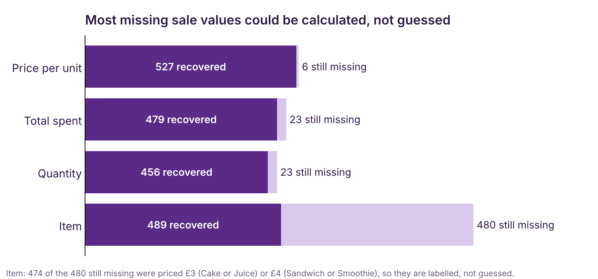

# Café Sales Data Cleanup

A year of café sales where 69% of the records had an error, cleaned so that 99.8% of sales now have a trustworthy amount, without guessing a single value.

**Tools:** Excel, PostgreSQL

**Owner report:** [report/cafe_data_quality_report.pdf](report/cafe_data_quality_report.pdf)

---

## The business problem

A small café's till system exported a year of sales (2023), but the file is full of "ERROR", "UNKNOWN" and blank cells. The owner can't trust any total from it.

The job: find every problem, fix what can be fixed, label what can't, and tell the owner how much of their sales data is actually reliable.

---

## Results

| Measure | Before | After |
|---|---|---|
| Sales with a known amount | 9,498 | **9,977** (99.8%) |
| Revenue that can be counted | £84,763.50 | **£89,096.00** |
| Sales with item, quantity, price and total all known | 7,732 | **9,500** |
| Sales with every field known | 3,089 | **3,771** |

**£4,332.50 of sales** were in the file but hidden by errors. They can now be counted. Only 23 of 10,000 sales still have no amount.

---

## The data

| Item | Detail |
|---|---|
| Source | [Cafe Sales: Dirty Data for Cleaning Training](https://www.kaggle.com/datasets/ahmedmohamed2003/cafe-sales-dirty-data-for-cleaning-training) (Kaggle, Ahmed Mohamed) |
| Period | 1 January to 31 December 2023 |
| Size | 10,000 sales, 8 columns |
| Columns | Transaction ID, Item, Quantity, Price Per Unit, Total Spent, Payment Method, Location, Transaction Date |

The raw file is not stored in this repository. It can be downloaded from the source link above.

---

## First look (Excel)

**6,911 of 10,000 sales (69%) had at least one bad value.** Deleting them would have thrown away most of the data.

| Column | Blank | ERROR | UNKNOWN | Total bad |
|---|---|---|---|---|
| Item | 333 | 292 | 344 | 969 |
| Quantity | 138 | 170 | 171 | 479 |
| Price Per Unit | 179 | 190 | 164 | 533 |
| Total Spent | 173 | 164 | 165 | 502 |
| Payment Method | 2,579 | 306 | 293 | 3,178 |
| Location | 3,265 | 358 | 338 | 3,961 |
| Transaction Date | 159 | 142 | 159 | 460 |

Two checks in Excel showed that much of it could be rescued:

1. **Every menu item has one fixed price.** A PivotTable of item against price shows each item at exactly one price: Cookie £1, Tea £1.50, Coffee £2, Cake £3, Juice £3, Sandwich £4, Smoothie £4, Salad £5.
2. **Quantity × Price = Total** in all 8,544 records where all three are known, with no exceptions.

---

## Cleaning approach (PostgreSQL)

Each stage was saved as its own table, so every step can be checked and rerun. The raw table was never changed.

| Stage | Table | What happened |
|---|---|---|
| 1. Standardise | cafe_typed | Blank, "ERROR" and "UNKNOWN" all became one kind of missing value (NULL); numbers and dates given proper types |
| 2. Rescue | cafe_rescued | Missing values calculated from menu prices and Quantity × Price = Total; every recovered value flagged |
| 3. Label | cafe_clean | Unrecoverable values labelled, never guessed; an `amount_status` column marks each sale as Original, Recovered or Missing |
| 4. Prove | – | No "ERROR" or "UNKNOWN" left; 9,974 records re-checked, 0 mismatches |

**What was rescued**

| Field | Missing before | Recovered | Still missing | How |
|---|---|---|---|---|
| Price per unit | 533 | 527 | 6 | From the item's menu price, or Total ÷ Quantity |
| Total spent | 502 | 479 | 23 | Quantity × Price |
| Quantity | 479 | 456 | 23 | Total ÷ Price |
| Item | 969 | 489 | 480 | From the price, where only one item has that price |

**What could not be rescued**

| Field | Sales affected | Labelled as |
|---|---|---|
| Location | 3,961 | Unknown |
| Payment method | 3,178 | Unknown |
| Date | 460 | Left empty |
| Item priced £3 | 247 | Cake or Juice |
| Item priced £4 | 227 | Sandwich or Smoothie |
| Item with no price | 6 | Unknown |

---

## Judgement calls

- **Rescue before deleting.** Dropping every row with an error would have removed 69% of the data. Calculating the missing values kept 99.8% of sale amounts.
- **Label, never guess.** A £3 item could be Cake or Juice, so it is labelled "Cake or Juice" rather than assigned one at random. A wrong value is worse than an honest gap.
- **Missing dates stay empty.** A made-up date would distort any monthly analysis.
- **Every recovered value is flagged,** so original and calculated figures can always be told apart.

---

## Recommendations for the owner

1. Make payment method and location required fields in the till. They cause most of the remaining gaps.
2. Find out why the till writes "ERROR" and "UNKNOWN". They appear across every field, which points to a system or export fault.
3. Give items that share a price (Cake and Juice, Sandwich and Smoothie) distinct product codes.
4. Run these checks on the export every month, so problems are caught within weeks.

---

## Repository contents

| Folder | File | Purpose |
|---|---|---|
| sql | 01_load_raw.sql | Loads the CSV and counts the bad values in each column |
| sql | 02_clean.sql | Standardises, rescues, labels and proves the cleaned data |
| excel | cafe_first_look.xlsx | The first-look checks: bad values, PivotTable and Quantity × Price check |
| images | (screenshots) | Excel checks, SQL results and the rescue chart |
| report | cafe_data_quality_report.pdf | One-page report for the café owner |

## How to reproduce

1. Download the dataset from Kaggle and save `dirty_cafe_sales.csv` to `C:\Users\Public\`.
2. In PostgreSQL, create a database called `cafe_sales`.
3. Run `sql/01_load_raw.sql`, then `sql/02_clean.sql`.

---

*Author: Blessing*
